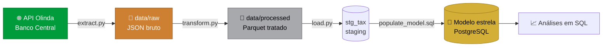
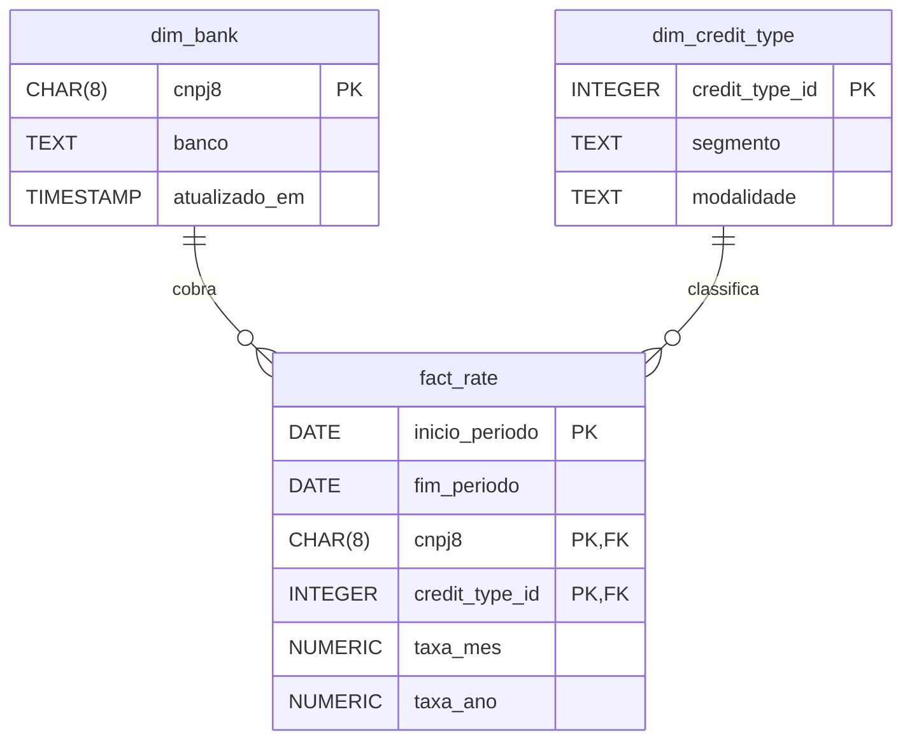

<div align="center">

# 💸 Monitor de Juros dos Bancos

**Quanto cada banco do Brasil cobra para te emprestar dinheiro? Este pipeline responde, com dados oficiais do Banco Central.**

[](https://www.python.org/)
[](https://pandas.pydata.org/)
[](https://www.postgresql.org/)
[](https://docs.docker.com/compose/)
[](https://parquet.apache.org/)

[](https://olinda.bcb.gov.br/olinda/servico/taxaJuros/versao/v2/aplicacao#!/recursos)


[Visão geral](#-visão-geral) •
[Arquitetura](#%EF%B8%8F-arquitetura) •
[Modelo de dados](#-modelo-de-dados) •
[Como rodar](#-como-rodar) •
[Decisões de engenharia](#-decisões-de-engenharia) •
[Roadmap](#%EF%B8%8F-roadmap)

</div>

---

## 🔎 Visão geral

Pipeline **ETL em lote** que coleta as **taxas de juros cobradas por cada instituição financeira** em operações de crédito, a partir da API de dados abertos do **Banco Central do Brasil**, trata os dados com **Pandas**, salva em **Parquet** e carrega num **modelo estrela** no **PostgreSQL** rodando em **Docker**.

> [!NOTE]
> Projeto de estudo em Engenharia de Dados, com foco em crédito e mercado financeiro.

### 📊 Um período em números

Só o período de **29/10/2026 a 05/11/2026** traz:

| 🏦 Instituições | 🧾 Tipos de crédito | 📄 Registros | 👥 Segmentos |
|:---:|:---:|:---:|:---:|
| **173** | **23** | **803** | Pessoa Física e Jurídica |

### 🔥 Spoiler: a diferença entre bancos é gigante

Taxas ao mês para **pessoa física** no mesmo período, direto dos dados coletados:

| Modalidade | 🟢 Mais barato | 🔴 Mais caro |
|---|---|---|
| Cartão de crédito rotativo | 0,74% a.m. | **24,99% a.m.** (≈ 1.354% a.a.) |
| Cheque especial | 1,80% a.m. | **14,01% a.m.** (≈ 383% a.a.) |
| Consignado INSS | 1,51% a.m. | 2,14% a.m. |
| Aquisição de veículos | 0,00% a.m. | 3,40% a.m. |

É exatamente esse tipo de comparação que o projeto automatiza.

## ❓ Perguntas que o projeto responde

- [x] Qual banco cobra **mais caro** em cada tipo de crédito?
- [ ] Qual banco cobra **mais barato** em cada tipo de crédito?
- [ ] Os juros dos bancos **acompanham a Selic**?
- [ ] **Bancos digitais** cobram menos que os bancos tradicionais?

## 🏗️ Arquitetura

Os dados passam por camadas no padrão **medalhão**:



| Camada | Onde fica | O que é |
|---|---|---|
| 🥉 **Bronze** | `data/raw/` | JSON exatamente como veio da API |
| 🥈 **Prata** | `data/processed/` | Tabela limpa, com nomes e tipos corrigidos, em Parquet |
| 🥇 **Ouro** | PostgreSQL | Staging + modelo estrela pronto para análise |

### O que cada etapa faz

| Etapa | Script | Responsabilidade |
|---|---|---|
| **Extract** | [`src/extract.py`](src/extract.py) | Descobre o período mais recente publicado e baixa todos os registros dele |
| **Transform** | [`src/transform.py`](src/transform.py) | Renomeia colunas para `snake_case`, tipa datas, preserva zeros do CNPJ e valida grão e nulos |
| **Load** | [`src/load.py`](src/load.py) | Cria as tabelas, faz carga incremental na `stg_tax` e popula as dimensões e a fato |
| **Analyze** | [`sql/analise_mais_caro.sql`](sql/analise_mais_caro.sql) | Ranking com `RANK() OVER (...)` para achar o banco mais caro por modalidade |

## 🧩 Modelo de dados

Modelagem dimensional em **esquema estrela**:



### Grão da tabela

Cada linha representa **um banco, numa modalidade de crédito, para um tipo de cliente, num período**:

```
inicio_periodo + segmento + modalidade + cnpj8
```

Essa combinação é única e serve de chave para impedir duplicação na carga.

<details>
<summary><b>📖 Dicionário de dados (camada prata)</b></summary>

<br/>

| Coluna | Tipo | Descrição |
|---|---|---|
| `inicio_periodo` | data | Início do período de apuração |
| `fim_periodo` | data | Fim do período de apuração |
| `segmento` | texto | Pessoa física ou pessoa jurídica |
| `modalidade` | texto | Tipo de crédito + tipo de taxa (prefixado/pós-fixado) |
| `banco` | texto | Nome da instituição financeira |
| `taxa_mes` | decimal | Taxa de juros ao mês, em % |
| `taxa_ano` | decimal | Taxa de juros ao ano, em % |
| `cnpj8` | texto | Raiz do CNPJ (8 dígitos), identifica o banco |

</details>

## 🌐 Fonte dos dados

**API Olinda do Banco Central**: conjunto *Taxas de juros de operações de crédito por instituição financeira*.

- **Endpoint:** `TaxasJurosDiariaPorInicioPeriodo`
- **Acesso:** público, sem chave de API
- **Granularidade:** cada taxa é a **média de um período** (início e fim)

> [!IMPORTANT]
> Um período novo é publicado a cada dia útil, com cerca de três semanas de atraso. Cada taxa é a média de uma janela de 5 dias úteis, e as janelas se sobrepõem: o período que começa em 29/10 e o que começa em 30/10 compartilham quase todos os dias. Para análises ao longo do tempo, use um período por semana ou por mês.

## 🚀 Como rodar

**Pré-requisitos:** Python 3.12+, Docker e Git.

```bash
# 1. Clone o repositório
git clone https://github.com/SaaaS04/Monitor_de_juros.git
cd Monitor_de_juros

# 2. Crie o ambiente virtual e instale as dependências
python3 -m venv .venv
source .venv/bin/activate
pip install -r requirements.txt

# 3. Configure as variáveis de ambiente
cp .env.example .env

# 4. Suba o PostgreSQL
docker compose up -d

# 5. Rode o pipeline
python src/extract.py
python src/transform.py
python src/load.py
```

> [!WARNING]
> Depois do `cp`, edite o `.env` e defina seu próprio usuário e senha antes de subir o banco.

> [!TIP]
> No Windows (PowerShell), ative o ambiente com `.\.venv\Scripts\Activate.ps1` e use `copy` no lugar de `cp`.

Saída esperada do `load.py`:

```
taxas_AAAA-MM-DD.parquet: N linhas lidas, N novas na stg_tax
Modelo: N bancos, N tipos de crédito, N taxas
```

Para ver o banco mais caro em cada modalidade:

```bash
docker exec -i monitor_juros_db psql -U <seu_usuario> -d monitor_juros < sql/analise_mais_caro.sql
```

## 🧠 Decisões de engenharia

| Decisão | Por quê |
|---|---|
| 🗄️ **Bruto preservado** | O JSON original é salvo antes de qualquer tratamento. Se a limpeza tiver erro, dá para refazer sem chamar a API de novo. |
| 🔁 **Idempotência** | Os arquivos levam a data do período no nome (`taxas_2026-10-29.json`) e a carga usa `ON CONFLICT DO NOTHING`. Rodar de novo não gera cópias. |
| 🚨 **Falhar alto** | O pipeline para com erro claro se a API falhar, se a resposta bater no limite de linhas (dado possivelmente incompleto), se houver duplicatas no grão ou nulos em colunas obrigatórias. |
| 📦 **Parquet em vez de CSV** | Preserva os tipos: datas continuam datas e o `cnpj8` mantém os zeros à esquerda (`07656500`). |
| 🪪 **`cnpj8` como identificador** | O nome do banco pode mudar (fusão, troca de marca), o CNPJ não. A `dim_bank` guarda sempre o nome mais recente. |
| ⭐ **Esquema estrela** | Separa quem cobra (`dim_bank`) e o que é cobrado (`dim_credit_type`) dos números (`fact_rate`), deixando as análises simples e rápidas. |
| 🐍 **Colunas `snake_case`** | Padrão do PostgreSQL, sem precisar de aspas nas consultas. |
| 🧮 **Derivados não são guardados** | O ranking dos bancos é recalculado em SQL com `RANK() OVER (...)`, nunca fica desatualizado. |
| 🔐 **Segredos fora do código** | Credenciais ficam no `.env`, que não vai para o Git. |

## 📁 Estrutura do projeto

```
Monitor_de_juros/
├── src/
│   ├── extract.py            # busca o período mais recente e salva o JSON bruto
│   ├── transform.py          # limpa, valida e salva em Parquet
│   └── load.py               # carga incremental e população do modelo estrela
├── sql/
│   ├── create_stg_tax.sql    # tabela de staging
│   ├── insert_stg_tax.sql    # insert idempotente na staging
│   ├── create_model.sql      # dimensões e fato
│   ├── populate_model.sql    # staging → modelo estrela
│   └── analise_mais_caro.sql # banco mais caro por modalidade
├── exploracao/               # scripts de estudo da API
├── data/                     # (fora do Git)
│   ├── raw/                  # 🥉 bronze
│   └── processed/            # 🥈 prata
├── docker-compose.yml        # PostgreSQL 17 em container
├── requirements.txt          # dependências Python
├── .env.example              # modelo das variáveis de ambiente
└── .gitignore
```

## 👤 Autor

<div align="center">

**Saulo** · Estudante de Ciência da Computação

[](https://github.com/SaaaS04)

⭐ Se este projeto te ajudou ou te inspirou, deixe uma estrela!

</div>
