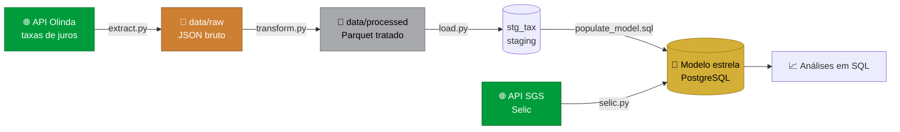
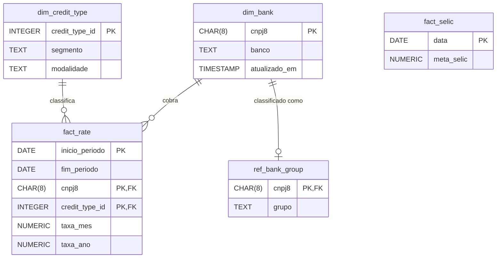

<div align="center">

# 💸 Monitor de Juros dos Bancos

**Quanto cada banco do Brasil cobra para te emprestar dinheiro, e o que explica essa diferença? Este pipeline responde, com dados oficiais do Banco Central.**

[](https://www.python.org/)
[](https://pandas.pydata.org/)
[](https://www.postgresql.org/)
[](https://docs.docker.com/compose/)
[](https://parquet.apache.org/)

[](https://dadosabertos.bcb.gov.br/)


[Visão geral](#-visão-geral) •
[Resultados](#-resultados) •
[Arquitetura](#%EF%B8%8F-arquitetura) •
[Modelo de dados](#-modelo-de-dados) •
[Como rodar](#-como-rodar) •
[Decisões de engenharia](#-decisões-de-engenharia)

</div>

---

## 🔎 Visão geral

Pipeline **ETL em lote** que coleta as **taxas de juros cobradas por cada instituição financeira** em operações de crédito, a partir das APIs de dados abertos do **Banco Central do Brasil**, trata os dados com **Pandas**, salva em **Parquet** e carrega num **modelo estrela** no **PostgreSQL** rodando em **Docker**. As análises são feitas em **SQL**.

> [!NOTE]
> Projeto de estudo em Engenharia de Dados, com foco em crédito e mercado financeiro.

### 📊 A base em números

| 📅 Período | 🗓️ Janelas diárias | 📄 Taxas | 🏦 Instituições | 🧾 Tipos de crédito |
|:---:|:---:|:---:|:---:|:---:|
| jan/2025 a out/2026 | **459** | **350.580** | **211** | **23** |

### ❓ Perguntas que o projeto responde

- [x] Qual banco cobra **mais caro** e **mais barato** em cada tipo de crédito?
- [x] **Bancos digitais** cobram menos que os bancos tradicionais?
- [x] Os juros dos bancos **acompanham a Selic**?

## 📈 Resultados

### 🔥 1. A diferença entre bancos é gigante

Taxas ao mês para **pessoa física** na janela iniciada em 30/10/2026, direto dos dados coletados:

| Modalidade | Bancos | 🟢 Mínima | Mediana | 🔴 Máxima |
|---|:---:|:---:|:---:|:---:|
| Cartão de crédito rotativo | 61 | 0,01% | **15,71%** | 24,99% |
| Cartão de crédito parcelado | 62 | 0,02% | **8,21%** | 19,49% |
| Cheque especial | 32 | 1,80% | **7,91%** | 13,45% |
| Crédito pessoal não consignado | 78 | 0,06% | **6,24%** | 21,40% |
| Aquisição de veículos | 41 | 0,00% | **1,80%** | 3,39% |
| Consignado INSS | 37 | 1,51% | **1,82%** | 2,14% |

A mediana do rotativo, 15,71% ao mês, equivale a cerca de **476% ao ano**.

> [!CAUTION]
> Os mínimos próximos de zero vêm de financeiras com pouco volume na modalidade ou de crédito subsidiado por fabricantes (montadoras, máquinas agrícolas). A **mediana** representa melhor a taxa que um cliente típico encontra.

### 📱 2. Bancos digitais não cobram menos, exceto no consignado

Comparação da mediana das **instituições digitais** (Nubank, C6, Inter, Mercado Crédito, PicPay) com a dos **grandes bancos tradicionais** (BB, Caixa, Itaú, Bradesco, Santander), ao longo de 42 janelas (set–out/2026):

| Modalidade | Janelas em que o digital foi mais caro | Diferença média (p.p. ao mês) |
|---|:---:|:---:|
| PF · Cartão rotativo | 100% | 🔴 +2,70 |
| PF · Crédito pessoal não consignado | 100% | 🔴 +0,97 |
| PJ · Capital de giro até 365 dias (prefixado) | 100% | 🔴 +3,35 |
| PF · Cartão parcelado | 95% | 🔴 +0,57 |
| PF · Consignado INSS | **0%** | 🟢 **−0,18** |
| PF · Consignado público | **0%** | 🟢 **−0,12** |
| PJ · Cheque especial | **0%** | 🟢 **−1,40** |

Os digitais foram **mais caros em 10 das 18 modalidades comparáveis**, de forma consistente. Foram **mais baratos no consignado**, o crédito de menor risco, em que a parcela é descontada direto do salário ou benefício.

**Hipótese:** os digitais cresceram atendendo clientes com menos histórico de crédito. Quando o risco do cliente pesa pouco no preço (consignado), eles competem e cobram menos; quando pesa muito (rotativo, crédito pessoal), seus clientes pagam mais.

> [!CAUTION]
> A comparação usa a mediana **por instituição**, sem ponderar pelo volume emprestado, e não controla o perfil dos clientes. A classificação entre digital e tradicional é uma escolha do projeto e está versionada em [`sql/seed_bank_group.sql`](sql/seed_bank_group.sql).

### 🏛️ 3. Quem acompanha a Selic depende do spread

Correlação mensal entre a mediana da taxa anual de cada modalidade e a meta da Selic, de jan/2025 a out/2026. No período, a Selic subiu de 12,25% para 15,00%, ficou estável por nove meses e caiu para 13,75%.

| Modalidade | Correlação (mesmo mês) | Melhor defasagem | Spread médio sobre a Selic |
|---|:---:|:---:|:---:|
| PJ · Desconto de duplicatas | **0,82** | mesmo mês | 8,9 p.p. |
| PJ · Antecipação de faturas de cartão | **0,81** | 1 mês (0,82) | 1,4 p.p. |
| PJ · Conta garantida (pós-fixado) | **0,80** | mesmo mês | 13,9 p.p. |
| PF · Consignado INSS | **0,73** | mesmo mês | 9,6 p.p. |
| PF · Consignado privado | 0,55 | **3 meses (0,92)** | 30,9 p.p. |
| PF · Cheque especial | −0,44 | nenhuma | 134,7 p.p. |
| PF · Cartão rotativo | −0,61 | nenhuma | **466,0 p.p.** |

- ⚡ **Repasse imediato** no crédito pós-fixado e de curto prazo para empresas: essas taxas são indexadas ao CDI, que acompanha a Selic.
- ⏳ **Repasse com atraso** em algumas modalidades prefixadas, como o consignado privado, cuja correlação chega a 0,92 com três meses de defasagem.
- 🚫 **Nenhuma relação** no crédito caro para pessoa física. Com spreads de centenas de pontos, a Selic é uma fatia pequena do preço. O cheque especial PF ainda tem teto legal de 8% ao mês, e as taxas estão perto dele.

> [!CAUTION]
> São 22 meses e um único ciclo da Selic. Séries com tendência própria podem gerar correlações altas sem relação real (correlação espúria), e foram calculadas 92 correlações, o que aumenta a chance de valores altos por acaso. Em 2025 houve mudanças nas regras do consignado privado, que podem ter movido essas taxas independentemente da Selic. Os resultados indicam tendências, não relações causais.

<details>
<summary><b>🔍 Consultas SQL das análises</b></summary>

<br/>

| Arquivo | O que responde |
|---|---|
| [`analise_mais_caro.sql`](sql/analise_mais_caro.sql) | banco mais caro por modalidade, com `RANK() OVER (...)` |
| [`analise_mais_barato.sql`](sql/analise_mais_barato.sql) | banco mais barato por modalidade |
| [`analise_resumo.sql`](sql/analise_resumo.sql) | mínimo, mediana (`PERCENTILE_CONT`) e máximo por modalidade |
| [`analise_digitais.sql`](sql/analise_digitais.sql) | digitais × tradicionais na janela mais recente, com self-join |
| [`analise_digitais_historico.sql`](sql/analise_digitais_historico.sql) | a mesma comparação em todas as janelas, com `COUNT(*) FILTER` |
| [`analise_selic.sql`](sql/analise_selic.sql) | correlação (`CORR`) e spread médio por modalidade |
| [`analise_selic_defasagem.sql`](sql/analise_selic_defasagem.sql) | correlação com a Selic de 1 a 3 meses antes, com `LAG()` |

</details>

## 🏗️ Arquitetura

Os dados passam por camadas no padrão **medalhão**. O [`main.py`](src/main.py) executa todas as etapas em sequência e interrompe o pipeline se qualquer uma falhar.



| Camada | Onde fica | O que é |
|---|---|---|
| 🥉 **Bronze** | `data/raw/` | JSON exatamente como veio das APIs |
| 🥈 **Prata** | `data/processed/` e `stg_tax` | Tabela limpa, com nomes e tipos corrigidos |
| 🥇 **Ouro** | PostgreSQL | Modelo estrela pronto para análise |

### O que cada etapa faz

| Etapa | Script | Responsabilidade |
|---|---|---|
| **Extract** | [`src/extract.py`](src/extract.py) | Descobre os dias úteis sem arquivo desde a data inicial e baixa cada janela |
| **Transform** | [`src/transform.py`](src/transform.py) | Trata cada JSON pendente: renomeia colunas, tipa datas, preserva zeros do CNPJ e valida grão e nulos |
| **Load** | [`src/load.py`](src/load.py) | Carrega as janelas que ainda não estão no banco e atualiza dimensões, fatos e classificação dos bancos |
| **Selic** | [`src/selic.py`](src/selic.py) | Extrai, trata e carrega a meta da Selic (série 432 do SGS) |
| **Orquestração** | [`src/main.py`](src/main.py) | Executa tudo em ordem e mede o tempo total |

## 🧩 Modelo de dados

Modelagem dimensional em **esquema estrela**, com uma tabela de referência mantida manualmente e a série da Selic:



| Tabela | Tipo | Conteúdo |
|---|---|---|
| `stg_tax` | staging | dados tratados, como vieram do Parquet |
| `dim_bank` | dimensão | uma instituição por linha, identificada pelo `cnpj8` |
| `dim_credit_type` | dimensão | uma combinação de segmento + modalidade por linha, com chave substituta |
| `fact_rate` | fato | uma taxa por instituição, tipo de crédito e janela |
| `ref_bank_group` | referência | classificação manual: `digital` ou `tradicional` |
| `fact_selic` | fato | meta da Selic por dia |

### Grão da tabela

Cada linha representa **um banco, numa modalidade de crédito, para um tipo de cliente, numa janela**:

```
inicio_periodo + segmento + modalidade + cnpj8
```

Essa combinação é única e serve de chave para impedir duplicação na carga.

<details>
<summary><b>📖 Dicionário de dados (camada prata)</b></summary>

<br/>

| Coluna | Tipo | Descrição |
|---|---|---|
| `inicio_periodo` | data | Início da janela de apuração |
| `fim_periodo` | data | Fim da janela de apuração |
| `segmento` | texto | Pessoa física ou pessoa jurídica |
| `modalidade` | texto | Tipo de crédito + tipo de taxa (prefixado/pós-fixado) |
| `banco` | texto | Nome da instituição financeira |
| `taxa_mes` | decimal | Taxa de juros ao mês, em % |
| `taxa_ano` | decimal | Taxa de juros ao ano, em % |
| `cnpj8` | texto | Raiz do CNPJ (8 dígitos), identifica o banco |

</details>

## 🌐 Fontes dos dados

| Fonte | Conjunto | Formato |
|---|---|---|
| [API Olinda](https://olinda.bcb.gov.br/olinda/servico/taxaJuros/versao/v2/aplicacao#!/recursos) | Taxas de juros de operações de crédito por instituição financeira (`TaxasJurosDiariaPorInicioPeriodo`) | OData, datas `AAAA-MM-DD` |
| [API SGS](https://dadosabertos.bcb.gov.br/dataset/432-taxa-de-juros---meta-selic-definida-pelo-copom) | Série 432: meta da Selic definida pelo Copom | datas `DD/MM/AAAA`, valores como texto |

As duas são públicas e não exigem chave de API.

> [!IMPORTANT]
> Um período novo é publicado a cada dia útil, com cerca de três semanas de atraso. Cada taxa é a média de uma janela de 5 dias úteis, e as janelas se sobrepõem: o período que começa em 29/10 e o que começa em 30/10 compartilham quase todos os dias. Por isso, as análises ao longo do tempo agregam por mês.

**🧪 Observações de qualidade de dados:**

- Os campos `codigoSegmento` e `codigoModalidade` vêm sempre vazios e são descartados.
- Há taxas iguais ou próximas de zero em modalidades caras, preservadas como vieram da fonte.
- A janela de 20/01/2026 não foi publicada, embora não seja feriado nacional. O pipeline a consulta novamente a cada execução e a carrega se for publicada depois.

## 🚀 Como rodar

**Pré-requisitos:** Python 3.12+, Docker e Git.

```bash
# 1. Clone o repositório
git clone https://github.com/SaaaS04/Monitor_de_juros.git
cd Monitor_de_juros

# 2. Crie o ambiente virtual e instale as dependências
python3 -m venv .venv
source .venv/bin/activate
pip install -r requirements.txt

# 3. Configure as variáveis de ambiente
cp .env.example .env

# 4. Suba o PostgreSQL
docker compose up -d

# 5. Rode o pipeline completo
python src/main.py
```

> [!WARNING]
> Depois do `cp`, edite o `.env` e defina seu próprio usuário e senha antes de subir o banco.

> [!TIP]
> No Windows (PowerShell), ative o ambiente com `.\.venv\Scripts\Activate.ps1` e use `copy` no lugar de `cp`.

A primeira execução faz a **carga histórica** desde janeiro de 2025 e leva cerca de 15 minutos. As seguintes buscam só o que falta e terminam em segundos. Exemplo de saída numa execução incremental:

```
[extract] 1 dias para verificar até AAAA-MM-DD
[extract] AAAA-MM-DD: N registros
[extract] 1 períodos novos salvos
[transform] 1 arquivos para tratar
[transform] taxas_AAAA-MM-DD.parquet: N linhas
[load] 1 períodos para carregar
[load] taxas_AAAA-MM-DD.parquet: N linhas
[load] Modelo: N bancos, N tipos de crédito, N taxas
[selic] N dias lidos, N novos, de 01/10/2024 a DD/MM/AAAA
[main] Pipeline concluído em Ns
```

Para rodar uma análise:

```bash
docker exec -i monitor_juros_db psql -U <seu_usuario> -d monitor_juros -P pager=off < sql/analise_resumo.sql
```

## 🧠 Decisões de engenharia

| Decisão | Por quê |
|---|---|
| 🗄️ **Bruto preservado** | O JSON original é salvo antes de qualquer tratamento. Se a limpeza tiver erro, dá para refazer sem chamar a API de novo. |
| 🧩 **Incremental que preenche lacunas** | Cada etapa compara o que existe com o que falta, em vez de olhar só a data mais recente. A mesma lógica faz a carga histórica, recupera dias perdidos se o pipeline ficar parado e permite retomar uma carga interrompida. |
| 🔁 **Idempotência** | Os arquivos levam a data da janela no nome e são sobrescritos; no banco, `ON CONFLICT` ignora o que já existe. Rodar de novo não gera cópias. |
| 🔒 **Transação única na carga** | A staging e o modelo são atualizados na mesma transação. Se algo falhar, nada fica gravado pela metade. |
| 🚨 **Falhar alto** | O pipeline para com erro claro se a API falhar, se a resposta bater no limite de linhas (dado possivelmente incompleto), se houver duplicatas no grão ou nulos em colunas obrigatórias. |
| 📦 **Parquet em vez de CSV** | Preserva os tipos: datas continuam datas e o `cnpj8` mantém os zeros à esquerda. O Banco do Brasil, por exemplo, é `00000000`. |
| 🧱 **Tipos rigorosos no banco** | `DATE`, `CHAR(8)` para o CNPJ, `NUMERIC` para as taxas (sem erro de arredondamento), `NOT NULL`, chaves estrangeiras e `CHECK`. |
| 🪪 **`cnpj8` como identificador** | O nome do banco pode mudar (fusão, troca de marca), o CNPJ não. A `dim_bank` guarda sempre o nome mais recente. |
| ⭐ **Esquema estrela** | Separa quem cobra (`dim_bank`) e o que é cobrado (`dim_credit_type`) dos números (`fact_rate`), deixando as análises simples e rápidas. |
| 🏷️ **Classificação manual separada** | Os grupos digital/tradicional ficam em `ref_bank_group`, e não na `dim_bank`, para não misturar dado da fonte com decisão do projeto. O arquivo do seed é a fonte da verdade. |
| 📏 **Mediana em vez de média ou extremos** | Taxas próximas de zero e muito altas distorcem médias e rankings. A mediana representa o cliente típico. |
| 🐍 **Colunas `snake_case`** | Padrão do PostgreSQL, sem precisar de aspas nas consultas. |
| 🧮 **Derivados não são guardados** | Rankings são recalculados em SQL com `RANK() OVER (...)`, nunca ficam desatualizados. |
| 🔐 **Segredos fora do código** | Credenciais ficam no `.env`, que não vai para o Git. |

## 📁 Estrutura do projeto

```
Monitor_de_juros/
├── src/
│   ├── main.py                       # executa o pipeline completo
│   ├── extract.py                    # baixa as janelas que faltam
│   ├── transform.py                  # trata e valida os JSON pendentes
│   ├── load.py                       # carrega na staging e atualiza o modelo
│   └── selic.py                      # extrai e carrega a meta da Selic
├── sql/
│   ├── create_stg_tax.sql            # tabela de staging
│   ├── insert_stg_tax.sql            # insert idempotente na staging
│   ├── create_model.sql              # dimensões e fato
│   ├── populate_model.sql            # staging → modelo estrela
│   ├── seed_bank_group.sql           # classificação digital/tradicional
│   ├── create_selic.sql              # tabela da Selic
│   ├── insert_selic.sql              # insert idempotente da Selic
│   └── analise_*.sql                 # consultas de análise
├── exploracao/                       # scripts de estudo da API
├── data/                             # (fora do Git)
│   ├── raw/                          # 🥉 bronze
│   └── processed/                    # 🥈 prata
├── docker-compose.yml                # PostgreSQL 17 em container
├── requirements.txt                  # dependências Python
├── .env.example                      # modelo das variáveis de ambiente
└── .gitignore
```

## 👤 Autor

<div align="center">

**Saulo** · Estudante de Ciência da Computação (UNIT, Aracaju)

Estudando Engenharia de Dados com foco em crédito e finanças.

[](https://github.com/SaaaS04)

⭐ Se este projeto te ajudou ou te inspirou, deixe uma estrela!

</div>